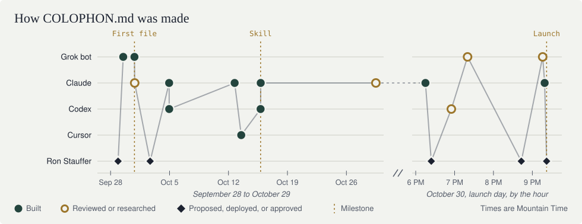

# Colophon

How this repository was made: which tools did the work, where they ran, what
each contributed, and who directed it. License and third-party notices live in
`LICENSE` and `fonts/`.

Private repositories are named with placeholders such as `<ios-app>`.

## Snapshot

| | |
|---|---|
| Project | colophon-md: the COLOPHON.md convention and its website |
| Primary builder | Claude, by Anthropic, for the public convention and website; Codex for one provenance update. The precursor files were written by several tools; see Origins |
| Surface | Claude cloud workspace, started from the Claude desktop app; Codex CLI for its update |
| Model / mode | Claude: Opus 5.5, configured for the sessions (`claude-opus-5-5`); the serving model was not independently verified; mode Unknown. Codex: `gpt-6-astra`, high, shown by the tool in its session log. The Grok bot reviewer and the precursor sessions: mostly Unknown |
| Editor | Claude sessions: none; the agent wrote the files directly. Codex CLI's enclosing editor: Unknown |
| Review | AI: a Grok bot reviewed the site, instructions, and template three times before launch, and wrote the change lists for versions 1.1 and 1.1.1. Ron Stauffer approved the launch |
| Directed by | Ron Stauffer |
| Human owner | Ron Stauffer (Lieder Digital): proposed the idea and the name `CREDITS.md` on 2026-09-28, directed the work, chose the COLOPHON.md name and byline, and approved the launch on 2026-10-30. The Grok bot says it drafted the first file's wording from his message. How closely he read every page is not recorded |
| Era | Idea proposed 2026-09-28; first file 2026-09-30; Codex skill 2026-10-15; public convention and website 2026-10-30; instructions versions 1.1 and 1.1.1 on 2026-10-31 (America/Denver) |
| Status | Live at https://colophon.md; public repository |

## How the work was done

Ron proposed the idea, and the name `CREDITS.md`, on September 28, 2026, in a
chat with a Grok bot, and asked whether an industry standard already existed.
The bot built a template over the next few days and added the first file to
one of his apps on September 30. On October 4, Ron asked Claude to pull the
idea out into a reusable kit, and Codex, Claude, and Cursor wrote more of these
files over the next two weeks. On October 15, Codex turned the examples into a
"repository-credits" skill, which Ron saved as a Claude skill that evening. On
October 30, Ron chose the COLOPHON.md name and byline, Claude adapted the skill
into public instructions and a template and built this website, and Ron put it
live. Codex and Claude then traced the idea's origins. A Grok bot reviewed the
site three times before launch, and Claude applied each round of fixes. On
October 31, Claude made versions 1.1 and 1.1.1 of the instructions from the
bot's change lists.

## Builder history (newest first)

| Date | Builder | Role | Surface | Model / mode | Contribution | Evidence |
|---|---|---|---|---|---|---|
| 2026-10-31 | Claude | Built | Cloud workspace (Claude desktop app) | Claude Opus 5.5 (configured for the session; the serving model was not independently verified) | Instructions versions 1.1 and 1.1.1 from the Grok bot's change lists. Version 1.1: the rule that a colophon describes the project, never the people; a Review field; an "Is this anti-AI?" question; a line on why this matters now; real favicon files, so search engines can show the site's icon; this file trimmed to a summary. Version 1.1.1: a required "Directed by" field; a note that context files describe what tools were told to do; an "Add your project" link; a new footer that keeps Ron's name; `CONTRIBUTING.md` | Observed in session; commit `1226565` (version 1.1) and the version 1.1.1 commit |
| 2026-10-31 | Grok Bot, directed by Ron Stauffer | Reviewed; no code written | Grok Bot Mac and iPhone apps (per the bot) | Unknown (not shown by the tool; no self-report used) | Change lists for versions 1.1 and 1.1.1 | Both, shared by Ron |
| 2026-10-30 | Grok Bot, directed by Ron Stauffer | Pre-launch reviewer; no code written | Grok Bot Mac and iPhone apps (per the bot) | Unknown (not shown by the tool; no self-report used) | Three reviews before launch: fixes, a re-check, and a final pass | All three, shared by Ron |
| 2026-10-30 | Ron Stauffer | Approved | Codex CLI; Claude app | Not applicable | Approved Codex's colophon update ("Looks good") before it was committed as `65f28b4`; approved the site, instructions, and template for launch after the Grok bot's reviews | Codex session transcript, provided by Ron; Owner-confirmed in the Claude session |
| 2026-10-30 | Ron Stauffer | Deployed | Cloudflare Pages; .MD registry; GitHub command line | Not applicable | Put the site live at colophon-md.pages.dev; registered colophon.md and connected it with SSL; redirected the pages.dev and www addresses to it; made the repository public | Owner-confirmed, with the receipt, dashboard screenshots, and terminal output he shared |
| 2026-10-30 | Claude | Built | Cloud workspace (Claude desktop app) | Claude Opus 5.5 (configured for the session; the serving model was not independently verified) | Built the site, instructions, and template, then revised them through the evening: roles, the no-extra-steps rules, the proactive and forensic mode names, the move to colophon.md, analytics, a gallery of timelines with hover details for each model, and each round of the Grok bot's fixes | Observed in session; each change is its own commit, from `07e8025` onward |
| 2026-10-30 | Claude | Researched and documented | Cloud workspace (Claude desktop app), with read access to Ron's GitHub repositories | Claude Opus 5.5 (session configuration) | Traced the convention's origins through the Git history of ten private repositories, earlier Claude chats, and records Ron provided; added Origins and Corrections; at Ron's request, replaced private repository names with placeholders and the bot's own name with "a Grok bot" | Observed in session; removal requests Owner-confirmed |
| 2026-10-30 | Codex, directed by Ron Stauffer | Researched and documented | CLI in `colophon-md` (session originator: `codex-tui`) | `gpt-6-astra`, high reasoning (shown by the tool in the session's turn context) | Searched local Codex history and skill files; separated the idea's origin from the recorded skill work; updated this colophon and kept the earlier Unknown row | Observed in that session; Ron requested the investigation |
| 2026-10-15 | Codex, directed by Ron Stauffer per the earlier skill record | Built | Desktop app on Ron's Mac; `<client-toolkit>` repository | Unknown | Added `skills/repository-credits`, its blank `CREDITS.md` template, and maintenance guidance. This is a recorded skill phase, not the first proposal of the idea | Repository records captured in an October 29 Codex session, later confirmed in Git; see Origins and Corrections |
| Before 2026-10-30 | Unknown | Unknown | Unknown | Unknown | Private "repository-credits" skill this convention is based on | Skill file read in session; its authorship Unknown. Later resolved in part; see Origins and Corrections |

## Origins

Before this repository existed, the convention grew as `CREDITS.md` files in
Ron's private repositories. Builders come from each commit and from the file's
own history table. Newest first.

| Date | Where | Builder | Surface | Model | What happened | Evidence |
|---|---|---|---|---|---|---|
| 2026-10-29 | Claude chat | Claude | Claude app | Unknown | Surveyed all 89 repositories Ron can access and found ten with a `CREDITS.md` | Claude chat history |
| 2026-10-18 to 2026-10-28 | Five more private repositories | Claude for the two on 2026-10-28; Unknown for the other three | Unknown | Claude Opus 5.5 for the two Claude commits, per their trailers; otherwise Unknown | The skill in regular use | Each repository's first `CREDITS.md` commit |
| 2026-10-15, evening | Claude chat | Claude, at Ron's request | Claude app | Unknown | Ron pasted the Codex skill, said he had made it in Codex, and saved it as the Claude skill "repository-credits." Its rules match the 2026-10-15 skill word for word; Claude wrote a stand-in template because the original wasn't pasted. Claude couldn't find the October 4 kit, because chat search doesn't reach chats inside Claude Projects | Claude chat history; the two skill files compared |
| 2026-10-15 19:29 | `<client-toolkit>` | Codex | Desktop app, per that repository's `CREDITS.md` | Unknown, per that file | Turned the earlier examples into the reusable "repository-credits" skill, with the Observed / Owner-confirmed / Unknown rules and a blank template | Commit `921ae5a` (released as `9ededfb`); its `CREDITS.md` cites "Ron's existing credits examples" |
| 2026-10-13 | `<wordpress-plugin>` | Committed under a "Cursor Agent" Git identity | Unknown | Unknown | Another early `CREDITS.md` | Commit `1cfc2d9`. A Git identity is not proof of the tool |
| 2026-10-12 | `<chrome-extension>` | Claude | Claude app, cloud workspace | Claude Opus 5.5, per the file and the commit trailer | Added a store-review notes section | Commit `bdbb1bf` |
| 2026-10-04 23:08 | `<company-site>` | Codex | Desktop app, per the file | GPT-6-based; exact model Unknown, per the file | The first `CREDITS.md` written by Codex, five minutes after Claude produced its one-file instructions for other AI tools. Whether Ron gave Codex that file is Unknown | Commit `b4d7086` |
| 2026-10-04 22:58 | Claude chat, in the session that built `<ios-app>` | Claude, at Ron's request | Claude app, cloud workspace | Unknown | **Claude's reusable kit.** Ron asked Claude to "split out the whole idea and concept" so he could reuse it. Claude made a plain-English guide with 10 rules, a blank template, a Claude skill, and a single instructions file for any other AI tool | Export of the Claude session, provided by Ron |
| 2026-09-30 | `<ios-app>` | A Grok bot | Grok Bot Mac app, working through GitHub without a local copy, via a pull request | Unknown | **The earliest `CREDITS.md` found.** It already had the snapshot table, a newest-first builder history, and inline notes asking Ron to confirm what wasn't known. Its pull request listed those as open questions; over the next hour the bot filled in Ron's answers, which he relayed from the Claude session building the app. That session first mentions `CREDITS.md` about 20 minutes after the bot's first commit. Ron merged the pull request on October 2. The bot says it wrote the first-person "Why this file exists" paragraph, adapting Ron's September 28 message: the ideas and the list of tools are Ron's, and the wording is the bot's | Commits `7f3b5bf` (20:06), `c83e515` (20:46), and `84acb12` (21:06), under the bot's Git identity; merge commit `513ce07` (2026-10-02 16:41); the file's own history row; the pull request description, an export of the Claude session, and the bot's answers, all provided by Ron |
| 2026-09-29 to 2026-10-01 | Grok Bot chat | A Grok bot, with Ron | Grok Bot Mac app | Unknown | Built the template, and saved the bot's own `CREDITS.md` skill around October 1 | The bot's condensed notes, relayed by Ron; its detailed record of these days is no longer available |
| 2026-09-28 21:22 | Grok Bot chat | Ron Stauffer | Grok Bot Mac app, from Ron's Mac | Not applicable | **Where it started.** Ron proposed the idea and the name: "I'm thinking of a new idea which would be adding a document called CREDITS.md." He wanted a standalone file rather than part of the README, and asked whether an industry standard already existed | The Grok bot's transcript of that chat, quoted word for word by the bot and relayed by Ron |

## Corrections

Earlier entries stay as written; each correction says what changed.

- **2026-10-30:** Repository records captured in an October 29 Codex session
  resolved the skill's date, tool, surface, repository, and direction (October
  15, Codex desktop, `<client-toolkit>`, directed by Ron). They didn't resolve
  who first proposed the idea, or how the skill's wording was split between Ron
  and Codex.
- **2026-10-30, later:** Git history confirmed the October 15 skill commit
  (`921ae5a`) and found an earlier file, from September 30, written by a Grok
  bot, not Codex. This corrected Ron's tentative recollection that the idea
  began in Codex: Codex wrote the October 4 file and the October 15 skill. At
  Ron's request, private repository names became placeholders and the bot's own
  name became "a Grok bot"; no other facts changed.
- **2026-10-30, later still:** The export of the Claude session that built
  `<ios-app>` showed Claude making a reusable kit on October 4, and showed the
  idea first coming up there about 20 minutes after the Grok bot's first
  commit, so it didn't start there.
- **2026-10-30, latest:** The Grok bot found Ron's first message, from
  September 28 at 9:22 PM, proposing both the idea and the name `CREDITS.md`.
  That settled who (Ron) and where (a chat with the Grok bot). It also
  corrected the previous entry's claim that Claude's October 4 kit was the
  first reusable version: the bot built a template and saved its own skill
  between September 29 and October 1.
- **2026-10-30, final:** Asked again, the bot reported that it wrote the first
  file's "Why this file exists" paragraph itself, adapting Ron's September 28
  message. The ideas and the list of tools are Ron's; most of the wording is
  the bot's. This rests on the bot's condensed record and the first commit.
- **2026-10-30, at launch:** Ron approved the site for launch, settling the
  earlier "review of the first site version: Unknown" as far as approval goes.
- **2026-10-31:** The site's timeline now gives the bot's second review as
  about 9:30 PM, per the bot's change list; it had said about 9:26 PM. The
  bot's model is now described as not shown by the tool, with no self-report
  used, instead of "nothing recorded it." Same-day rows were combined; the
  longer version of this file is in Git history.

## Evidence limits

- This file follows COLOPHON.md instructions version 1.1.1. Dates use
  America/Denver; session timestamps were converted from UTC.
- The launch, version 1.1, and version 1.1.1 entries come from the Claude sessions that did
  the work. Claude's model is the one configured for those sessions; the
  serving model was not independently verified.
- Codex's update inspected this repository's files and first two commits
  (`07e8025`, `e7a7f62`), plus the local Codex session logs, command history,
  session archive, and installed `repository-credits` skill on the computer
  running that session. Other computers and other tools' logs were not
  searched. Its `gpt-6-astra` and high reasoning describe that session only,
  not the earlier skill session. Its `codex-tui` originator supports the CLI
  label, although its source field also says `vscode`; the enclosing terminal
  or editor is Unknown.
- The October 15 attribution comes from repository records, not a recovered
  October 15 transcript. That session's original drafting exchange, model, and
  reasoning setting are Unknown. Later use of the skill in Claude doesn't make
  Claude its original author.
- The Origins table comes from a later Claude session. It read the full Git
  history of the ten repositories with a `CREDITS.md`, two earlier Claude chats
  (October 15 and October 29), the September 30 pull request description, and
  an export of the Claude session that built `<ios-app>`; Ron provided the last
  two. Each early file's builder comes from its commit and its own history
  table, which the writing agent filled in.
- The Grok bot answered from its own records, relayed by Ron: a word-for-word
  transcript of September 28, and condensed notes for September 29 to October
  5. It can see only its own chat with Ron. ChatGPT, other tools, and other
  computers were not searched, so an earlier mention elsewhere can't be ruled
  out. The bot's model is Unknown.
- To keep this a summary rather than a log, same-day work is combined into one
  row per phase. Git history has each change.
